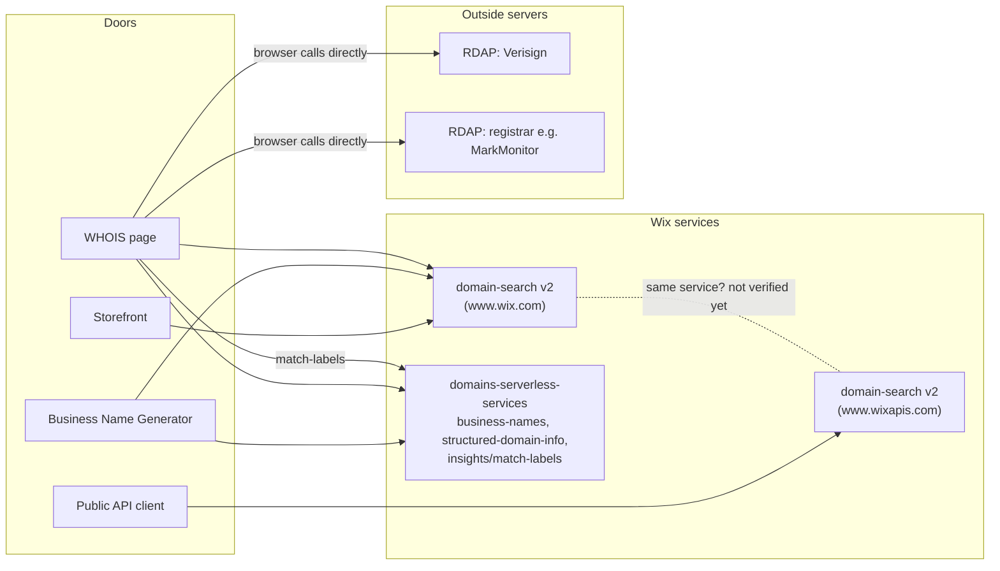

# Architecture

Wix has four "doors" that answer one question: "Can I get this name?".
This file shows how each door works. It is based on what I saw in DevTools
If I did not see something myself, it says "not verified yet".

## 1. Domain storefront - https://www.wix.com/domains

This is the main page for searching a domain. Example search: `mybakery`.

| Call | What it returns | On screen |
|---|---|---|
| `www.wix.com/domain-search/v2/check-domain-availability?domain=mybakery.com` | Says if this exact domain is free. It uses the same path and the same response format as the public API. | The message under the search box ("... is already registered. Explore some great alternatives below."). This matches the answer: `available: false`. |
| `www.wix.com/domain-search/v2/suggest-domains?query=mybakery&paging.limit=10` | 10 suggestions. `mybakery.co.il` is first (expected for Israel). It has a paging cursor (`next`). | The "Best Match" card, the "Great Alternative" card and the list below them. These match the answer (same domain names). |
| `list-tlds`, `suggested-tld-display-prices`, `tld-promotions`, `keywords`, `PREMIUM_DOMAINS`, `getIsOnSale` | Helper calls. | `suggested-tld-display-prices`: probably the prices in ILS (Israeli shekels) next to each domain, with an old price crossed out (not verified yet). `tld-promotions`, `getIsOnSale`: probably the "Free for 1 year" and "Intro offer" labels (not verified yet). `list-tlds`, `keywords`, `PREMIUM_DOMAINS`: not checked. |
| `mybakery.com?domainName=mybakery.com` (sent from `searchAggregations.js`) | 403 error. The reason is unknown. | Not checked. |

TLD means the ending of a domain, like `.com` or `.co.il`.

**Paging cursor** (a marker that tells the server which part of the results to send next). In `suggest-domains` it is called `next`.
It is base64 text (data written as plain letters and numbers). When decoded it is readable, not random.
It holds the suggestions on the screen, the next 3 suggestions that are waiting, and `"engine": "Llm"`.

## 2. Business Name Generator - https://www.wix.com/tools/business-name-generator

This page makes business names. Then it searches domains for a name.
The order is confirmed: first make names, then search domains for a name.

| Call | What it returns | On screen |
|---|---|---|
| `www.wix.com/_serverless/domains-serverless-services/v1/business-names/generate` | 6 names (the count varies between visits: 6 and 9 names seen). Each name has a `reasoning` text (it looks written by AI). | The list of business names on the left ("1. Choose a business name"). One visit showed 9 names. |
| `www.wix.com/domain-search/v2/suggest-domains?query=Bakerly` (the first name it made; host verified) | Domain suggestions for that name. | The domain list on the right ("2. Claim the perfect domain for &lt;name&gt;"), for the name you picked. This matches: the search text in the call is the name you picked. Note: the list showed 20 domains, but the call asks for only 10 (`paging.limit=10`). Maybe there are two calls (not verified yet). |
| `list-tlds`, prices, `PREMIUM_DOMAINS` | The same helper calls as the storefront. | Prices and the "Free for 1 year" / "Intro offer" labels: same as the storefront (not verified yet). `list-tlds`, `PREMIUM_DOMAINS`: not checked. |

## 3. WHOIS lookup - https://www.wix.com/domains/whois

This page shows that data for a domain. Example search: `google.com`.

| Step | Call | What it returns | On screen |
|---|---|---|---|
| 1 | Wix: `.../domains-serverless-services/v1/structured-domain-info/rdap-url?domain=google.com` | `{"url": "https://rdap.verisign.com/com/v1/"}` | Works together with steps 2 and 4. See step 4. |
| 2 | The browser calls Verisign directly: `rdap.verisign.com/com/v1/domain/google.com` (confirmed) | RDAP (the modern way to get WHOIS data) data. It has a link to the registrar, here MarkMonitor. | Works together with steps 1 and 4. See step 4. |
| 3 | A second call, to the registrar (the GOOGLE.COM row) | The registrar's RDAP data. | Probably the "Raw Registrar WHOIS Data" and "Terms of Service" sections (not verified yet). Note: "Raw Registrar WHOIS Data" showed "error: __raw: undefined". |
| 4 | Wix: `parse-rdap` (called twice) | Readable data for the page. Parse means turning raw data into clear fields. | "Domain Information" (created Sept 15 1997, updated Sept 9 2019, expires Sept 14 2028, nameservers (the servers that tell the internet where the domain points), domain status) and "Registrar Information" (MarkMonitor). These match the values in the Verisign RDAP answer. "Registrant Contact Information" shows "—" in all fields (redacted (hidden for privacy), which is expected). |
| 5 | `whois?domain=google.com&parse=false` | Not noted. | Probably the "Raw Registry WHOIS Data" section (raw text) (not verified yet). |
| - | `www.wix.com/domain-search/v2/check-domain-availability?domain=google.com` (called twice for the same domain; host verified) | Says if the domain is free. | The message at the top: "google.com is registered. Explore some great alternatives below." |
| - | `suggest-domains` (limit 5) | Suggestions. | "Explore these great alternatives" on the right. Exactly 5 domains. |
| - | `www.wix.com/_serverless/domains-serverless-services/v1/insights/match-labels` (status 200, seen on two visits; host verified) | Not noted. | Probably the labels on each alternative ("Great Alternative", "Most Popular", etc.) (not verified yet). |
| - | `google.com?domainName=google.com` | 403 error (same as the storefront). | Not checked. |

Risk: this page depends on servers outside Wix (Verisign and the registrar). If they are slow or down, the page breaks.

## 4. Public Domain Search API

An API for developers.
It is a REST API (an API you call with normal web addresses).
You need an account-level API key. There is no screen.

- Base URL: `https://www.wixapis.com/domain-search/v2/`
- Headers `Authorization` + `wix-account-id`
- `check-domain-availability?domain=google.com` -> `availability.available: false` (confirmed)
- The response fields are inside an `availability` object: `availability.domain`, `availability.available`, `availability.premium`, `availability.premiumType` (confirmed, and the docs agree)

## How the doors relate

- **domain-search** (`/domain-search/v2/`): the storefront, the name generator, WHOIS and the public API all call it.
  The storefront uses `www.wix.com`. The public API uses `www.wixapis.com`.
  For `check-domain-availability`, both use the same path and the same answer format (confirmed).
  Do both addresses lead to the same backend service? This is **not verified yet**.
- **domains-serverless-services**: the name generator uses it for `business-names`. WHOIS uses it for `structured-domain-info` and `insights/match-labels`.
- **Outside servers (RDAP: Verisign, registrars)**: only WHOIS uses them. The browser calls them directly.

## Diagram

